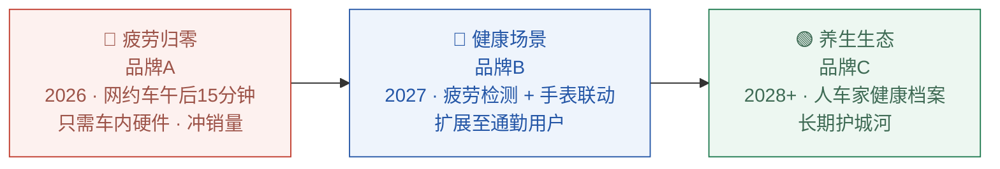

# 一个定位的诞生：创维汽车战略的推演之路

> 从"健康生态移动空间"到"疲劳归零空间"——五份报告、多轮红蓝军对抗之后，我们如何走到今天的最终版本
>
> 梦工场投资 · 2026年7月29日 · 汇报开场引导

---

## 0. 开场白：先讲路，再讲结论

**目的**：让对方在听结论之前，先看到结论是怎么被"打"出来的。

**讲演词**：

各位领导，今天我们要汇报的是创维汽车的战略定位最终方案。但在翻开正式 PPT 之前，我想先花几分钟，带大家走一遍这个定位**诞生的路**。

因为今天的结论，不是我们坐在会议室里一拍脑袋想出来的。过去一个多月，我们前后产出了**五份报告、一份专项质疑文件、两次落地讨论**，中间经历了完整的红蓝军对抗——自己提方案、自己组织力量攻击它、被打穿的地方推倒重构。最终版本，是从这套流程里活下来的那一个。

我先用一张图，把这条路讲清楚。

### 图1 · 六步推演路径

> 两轮建构（蓝）→ 一轮体检（金）→ 一轮对抗与重构（红）→ 最终收敛（绿）

---

## 1. 第一步：提出方向——"健康生态移动空间"

**文件**：`02 创维汽车战略定位与运营配称讨论稿`（2026年6月22日，首份提交）

**讲演词**：

一切从 6月22日 的第一份讨论稿开始。当时我们回答的是一个最根本的问题：**创维汽车凭什么在市场上活下来？**

我们扫描了六类竞争者——科技智能、性能操控、家庭空间、性价比、豪华身份、生态科技——发现一个惊人的事实：**所有品牌都在"功能层"竞争，没有一个品牌在"人的生命状态层"竞争。** 这是一个巨大的心智空位。

于是我们借用德鲁克之问（客户买的是时间里的生命体验）和张瑞敏的场景哲学（场景替代产品，生态覆盖行业），提出：创维不是卖汽车的，是卖**"健康生态移动空间"**的。广告语初定"上车，就是健康的开始"，并设计了早晨健康报告、午后能量恢复、归家场景联动三大场景。

**核心观点**：跳出功能内卷，开创"健康生态移动空间"新品类，占领生命状态层心智空位。
**背后原因**：创维有别人没有的结构：38年品牌 + 2亿家庭用户 + 横跨家电/消费医疗/汽车三大板块，这是唯一能支撑"健康生态"的底座。

---

## 2. 第二步：理论深化——"养生生态出行空间"

**文件**：`03 创维汽车战略定位深化报告` 与配套 `03 创维养生生态出行空间战略定位深化.pptx`

**讲演词**：

方向有了，第二步是把它锻造成一套完整的理论闭环。深化报告用**特劳特定位四步法**验证了品类空位真实存在，用**科特勒 4P→4C 框架**把定位翻译成产品、定价、渠道、传播的完整配称。

这一版做了一个关键升级：把"健康"聚焦为**"养生"**。我们对比了三个定位方案——A"被迫养生"、B"生命时光"、C"中国式健康"——从逻辑完整性、差异化、传播性、可落地性四个维度打分，最终选定方案 A，广告语升级为**"上车，就是养生的开始"**，战略总句定为"所有车企都在卖更好的车，创维在卖更健康的生命"。

坦率说，到这一步，方案看起来已经很完美了：理论扎实、叙事动人、路线图清晰。**如果我们停在这里，今天拿给各位的就是这一版。但我们没有停。**

**核心观点**："养生"比"健康"更聚焦、更有文化共鸣；三大场景 + 三年路线图（2026卡位 → 2027种草 → 2028定标准）。
**背后原因**：定位不是一句口号，必须贯穿所有经营环节；用经典战略框架做交叉验证，防止方向是"自嗨"。

---

## 3. 第三步：现实拷问——战略体检

**文件**：`01 创维汽车战略定位体检报告`（以销量现实检验定位方案）

**讲演词**：

方案做完，我们干的第一件事不是庆祝，而是**拿它去撞现实**。2023年销量曾达约1.86万辆峰值，但2025年全球仅3,763辆，两年跌去八成；2026年上半年境内月均约65台，品牌排名已滑落至90名开外。

体检报告的结论很冷静：战略定性是对的，但**"定位"与"销量"之间断了三根桥**——第一，顾客触点断层：用户在 4S 店感受不到任何"养生"；第二，安全口碑问题：历史碰撞测评成绩偏低，直接侵蚀"健康·生命"定位的可信基础；第三，渠道模式错配：传统 4S 店的话术是续航、智驾、优惠，承载不了体验流程。

这次体检让我们意识到：**方案的漂亮程度和落地能力是两回事。** 这也为后面更猛烈的自我攻击埋下了伏笔。

**核心观点**："定位已完成、销量仍低迷"的本质，是定位与顾客之间缺一条可见的桥；提出种子用户、体验中心、安全信任状等破局要点。
**背后原因**：战略不能只在纸面自洽，必须回答"2026年上半年境内月均约65台怎么破"这个最扎心的问题。

---

## 4. 第四步：红蓝军对决——三大核心质疑

**文件**：`创维汽车战略定位：三大核心质疑（详尽版）`（蓝军专项攻击文件）

**讲演词**：

这是整个过程中最关键、也最痛的一步。我们专门组织了**蓝军视角**，任务只有一个：把前两版报告往死里打。打的结果，是三发命中要害的炮弹。

我们完全可以捂住这三个质疑不讲，但那样今天的方案就是带病上会。**正是因为这三炮，才有了后面的重构。**

### 🔵 蓝军三炮（攻击） vs 🔴 红军回应（重构而非辩护）

| 🔵 蓝军三炮（攻击） | 🔴 红军回应（重构而非辩护） |
| --- | --- |
| **质疑一：分众类比不成立。** 等电梯是被动、零负荷的等待；开车是主动、高强度的输出。两种截然相反的生理行为，被强行套上同一个"时间转化"框架。 | **放弃分众类比**，改用"疲劳–恢复"框架：不在驾驶中做养生，而是在**接单间隙、等待时段**做恢复——生理逻辑成立。 |
| **质疑二："养生"得罪了所有该争取的用户。** 有钱养生的人买蔚来、理想，不买 10 万级的创维；买创维的网约车司机和刚需家庭，听到"养生"第一反应是"跟我没关系"。客群与价格带结构性错配。 | **换词不换向：** 健康方向保留，但把抽象的"养生"换成人人秒懂、身体可验证的**"疲劳归零"**；客群从"拓圈养生人群"改为**存量疲劳人群**（700万网约车司机 + 1亿通勤用户）。 |
| **质疑三：三大场景是个死循环。** 完整体验需要手表+汽车+家电三端齐备，没人会为体验功能买齐三件套——早期口碑永远无法自发启动。 | **单场景优先突破：** 锁定网约车午后 15 分钟，只用车内硬件（座椅+空净+音响）即可闭环，不依赖三件套，口碑当天就能启动。 |

**关键姿态**：面对质疑，我们没有为旧方案辩护，而是承认"这不是表达问题，是底层逻辑问题"，推倒重构。
**背后原因**：战略定位的本质不是"我有什么可以说"，而是"用户凭什么相信"。经不起内部蓝军攻击的方案，更经不起市场攻击。

---

## 5. 第五步：推倒重构——"疲劳归零空间"

**文件**：`04 创维汽车战略定位重构报告` → 收敛为 `05 创维汽车战略定位重构报告（最终版）`

**讲演词**：

重构报告开宗明义：**不推翻健康方向，重构健康与创维资源的结合方式。** 三个替换：用"疲劳归零"替代"养生"，用存量用户激活替代拓圈，用单一场景突破替代三场景齐发。

战略总句也随之进化——从"创维在卖更健康的生命"，变成**"众人追求更好的乘车功能，创维打造疲劳归零的移动空间"**。一字之差，背后是客群、场景、打法的全面落地。

### 重构前 vs 重构后（五维对比）

| 维度 | 重构前（②深化版） | 重构后（⑤最终版） |
| --- | --- | --- |
| **核心概念** | 养生（抽象，需教育） | 疲劳归零（功能性，零门槛，身体可验证） |
| **目标客群** | 中高收入养生人群（拓圈） | 网约车司机 + 通勤 + 刚需家庭（存量激活） |
| **启动场景** | 三大场景同时启动（需三端设备） | 网约车午后 15 分钟，仅需车内硬件 |
| **核心类比** | 分众"时间转化" | "疲劳–恢复"生理框架 |
| **战略总句** | 卖更健康的生命 | 打造疲劳归零的移动空间 |

**核心观点**：只做一个功能做到极致：15 分钟疲劳归零模式，效果当场可感知，1 个司机影响 10 个司机。
**背后原因**：10 万级用户的真实诉求是"不累"，不是"养生"；先打赢一个可验证的小切口，才有资格谈生态。

---

## 6. 第六步：收敛共识——漏斗式多品牌升级路径

**文件**：`创维汽车战略落地讨论 2026年7月29日`（两场会议纪要）+ `04 创维汽车战略定位重构报告0729.pptx`

**讲演词**：

7月29日，我们做了最后两轮落地讨论，把长期与短期的关系彻底捋顺，形成了三条共识：

**第一**，当前阶段的首要任务是快速提升销量，一切战略设计必须匹配现有资源禀赋——判断标准是三句话："内部可实现、外部能打赢、心智能认同"。

**第二**，采用漏斗式多品牌升级：第一阶段主打"消除疲劳"的用户认知，随后延伸到"健康"场景，最终落地"养生生态"。

**第三**，人车家健康档案是打完基础之后构建护城河的长期工程，不抢当下的戏。

也就是说：**前面几版报告没有一版被浪费**——养生生态是漏斗的远端愿景，疲劳归零是漏斗的近端入口，它们是同一条路上的不同里程碑。

### 图2 · 漏斗式多品牌升级路径

> 从小切口冲销量，到健康场景扩圈，再到养生生态护城河——远期愿景一寸未丢
> 判断标准：内部可实现 · 外部能打赢 · 心智能认同

---

## 7. 收尾与指引：正式进入最终版定位讲解

**讲演词 · 收尾**：

各位领导，回看这条路：两轮建构、一轮体检、一轮自我攻击、一轮推倒重构、两场落地讨论——**最终版本不是一蹴而就的灵感，而是被反复锤打后仍然站得住的结论。**

我们对自己方案开的每一炮，都是替市场提前开的；今天呈现的每一个判断，都已经先在内部红蓝军的对抗里活了下来。

**接下来，请允许我正式打开《创维汽车战略定位重构报告》PPT，用一句话作为开场——**

> **"众人追求更好的乘车功能，创维打造疲劳归零的移动空间。"**
> 【疲劳归零空间】对决【功能汽车】——下面进入正式讲解。

---

### 附：本讲演稿文件索引

`01体检报告` / `02讨论稿(6.22)` / `03深化报告及PPT` / `三大核心质疑(蓝军)` / `04重构报告及0729 PPT` / `05最终版` / `7.29两场落地讨论纪要`

*梦工场投资 · 仅供内部汇报使用*
